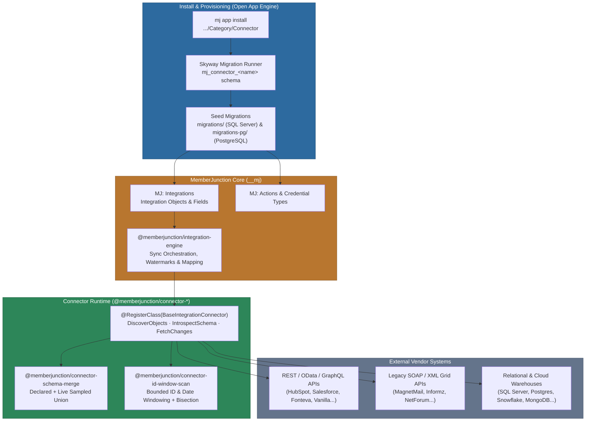

<p align="center">
  <picture>
    <source media="(prefers-color-scheme: dark)" srcset="https://github.com/MemberJunction/MJ/raw/main/MJ_logo_wide_dark.png">
    <source media="(prefers-color-scheme: light)" srcset="https://github.com/MemberJunction/MJ/raw/main/MJ_logo_wide.png">
    
  </picture>
</p>

<h3 align="center">The official vendor integration fleet for MemberJunction.</h3>

<p align="center">
  Connect the systems you already run. Replicate &amp; unify your data. <strong>Power AI agents across your entire stack.</strong>
</p>

<p align="center">
  <a href="#download--install">Install a Connector</a> &middot;
  <a href="#how-it-works-full-open-app-model">Open App Architecture</a> &middot;
  <a href="#key-capabilities">Capabilities</a> &middot;
  <a href="#creating--maintaining-a-connector">Build a Connector</a> &middot;
  <a href="#-full-integration-directory">Full Integration Directory</a>
</p>

<p align="center">
  <a href="./LICENSE"></a>
  <a href="#-full-integration-directory"></a>
  <a href="https://github.com/MemberJunction/MJ"></a>
  <a href="https://www.typescriptlang.org/"></a>
  <a href="https://docs.memberjunction.org"></a>
  <a href="https://github.com/MemberJunction/Integrations/issues"></a>
</p>

---

## What is MemberJunction Integrations?

**MemberJunction Integrations** is the official monorepo of vendor integration connectors for the [MemberJunction](https://github.com/MemberJunction/MJ) platform — spanning **Association Management (AMS)**, **CRM & Fundraising**, **Events & Awards**, **Finance & ERP**, **Learning Management (LMS)**, **Marketing & Engagement**, **Project Management**, and **Community, Content & Data Platforms**.

Every connector under `<Category>/<Connector>/` is architected as a **self-contained mini Open App** — complete with its own npm package (`@memberjunction/connector-<name>`), dedicated migration schema (`mj_connector_<name>`), dual-dialect metadata-seed migrations (**SQL Server** + **PostgreSQL**), credential setup guide, and independent release lifecycle.

Nothing is seeded into a MemberJunction database until you install the connector you want, and installing one connector pulls **only** that connector's package — keeping your host lightweight and fully decoupled.

```bash
# Install any connector on demand into your MemberJunction environment
mj app install https://github.com/MemberJunction/Integrations/CRM/HubSpot

# Or pin a specific subpath-scoped connector version
mj app install https://github.com/MemberJunction/Integrations/AMS/Fonteva --version 1.2.4
```

```typescript
// Discover live objects, introspect schema, and sync changes through @memberjunction/integration-engine
import { IntegrationEngine } from '@memberjunction/integration-engine';

const engine = IntegrationEngine.Instance;
await engine.Config(false, contextUser);

// Run incremental or windowed historical sync for any installed CompanyIntegration
const syncResult = await engine.RunIntegration(companyIntegrationId, contextUser);
```

---

## Key Capabilities

<table>
<tr>
<td width="50%" valign="top">

### Decoupled Open App Model
- **Install on demand** — `mj app install` provisions only the connectors you use
- **Zero unused metadata bloat** — Core `__mj` tables remain clean until a connector is installed
- **Dual-dialect migrations** — Deterministic SQL Server (`migrations/`) and PostgreSQL (`migrations-pg/`) seed scripts powered by [Skyway](https://github.com/MemberJunction/skyway)
- **Independent versioning** — Non-fixed Changesets (`<Category>-<Connector>@X.Y.Z`); a Salesforce patch never bumps HubSpot
- **Action catalog integration** — Pre-wired metadata Actions that `@lookup` the core MJ Action-Category and Credential Type trees

</td>
<td width="50%" valign="top">

### Enterprise Sync & Historical Migration
- **Incremental watermark sync** — Cursor, offset, keyset, and timestamp watermark tracking per object
- **Sliding date-window state machine** — Resumable `WindowCursor` (`v1|<Today>|<From>|<To>|<InnerPos>|<ScopeKey>`) for multi-year historical backfills across legacy/capped APIs
- **Adaptive window bisection** — Automatically splits dense date or numeric ID windows when a vendor endpoint hits an unpaginated response cap
- **Metered migration pacing** — Token-bucket rate limiting (`tokensPerSec`, `burst`, `minDelayBetweenRequestsMs`) and per-run budgets (`maxRequestsPerRun`, `maxWindowsPerRun`)
- **Bulk ID-window scanning** — `@memberjunction/connector-id-window-scan` for endpoints that cannot bulk-list

</td>
</tr>
<tr>
<td width="50%" valign="top">

### Live Schema Introspection & Safety
- **Hybrid schema discovery** — Unions static declared catalogs with live data-sampled fields via `@memberjunction/connector-schema-merge`
- **Live database & CRM introspection** — Dynamic table/column discovery for SQL Server, PostgreSQL, MySQL, Oracle, Snowflake, MongoDB, Salesforce, and Dynamics Dataverse
- **Semantic field sizing** — Empirical string-length inference (`infer-field-lengths.mjs`) prevents truncation or skipped records on prose, URL, and email fields
- **Parent-chain & PK guarantees** — Every nested/templated endpoint resolves to a verified parent object and primary key

</td>
<td width="50%" valign="top">

### 16-Gate CI & Evidence Discipline
- **Honest evidence tiers** — Every connector carries a `docs/SUPPORT.md` stating its exact verification tier (`🥇 Client-DB-live`, `🟢 Live-vendor`, `⚙️ Synthetic-local`, `🧪 Mock-only`, `🟡 Honest-NA`)
- **Three-way registration invariant** — `Integration.ClassName` == `@RegisterClass(BaseIntegrationConnector, …)` == `IntegrationName`
- **Collation-safe SQL & PG parity** — Automated CI checks enforce case-safe lookups and byte-for-byte PostgreSQL migration parity
- **Self-maintaining catalog & directory** — `connectors-catalog.json` and this README's integration directory are verified and updated via CI

</td>
</tr>
</table>

---

## Architecture



---

## How It Works (Full Open App Model)

Each `<Category>/<Connector>/` directory is a standalone MemberJunction Open App, structured identically to first-party MJ business applications:

- **Dedicated npm package (`@memberjunction/connector-<name>`)** — Exports the `@RegisterClass(BaseIntegrationConnector, …)` implementation and unit/contract test suite. Core MJ framework packages (`@memberjunction/core`, `@memberjunction/core-entities`, `@memberjunction/integration-engine`) are declared as **peer dependencies** supplied by the host.
- **Dedicated database schema (`mj_connector_<name>`)** — Serves as the Open App namespace and `flyway_schema_history` anchor so Skyway tracks each connector's migrations independently without polluting `__mj`.
- **Metadata-seed migrations (`migrations/` + `migrations-pg/`)** — Generated from `metadata/` via `mj sync push` and converted to PostgreSQL via `npm run migrations:pg`. Migrations execute `spCreateIntegration`, `spCreateIntegrationObject`, and `spCreateIntegrationObjectField` against `__mj` to register the vendor's object/field catalog and actions.
- **Declarative source of truth (`metadata/`)** — Human-authored JSON definitions for `integration/` (objects, fields, PKs, FK `@lookup`s, pagination rules, `DeclaredAgainst` freshness pins) and `actions/`.
- **Evidence & setup docs (`docs/`)** — Each connector ships a `docs/SUPPORT.md` (recording the exact verification tier, proven object/row counts, and known caveats) and a self-contained `docs/credential-setup.html` guide.

---

## Download & Install

### Installing a Connector into MemberJunction

Requires a MemberJunction host **>= 5.43.0** (which supports multi-app-per-repo subpath installs in `@memberjunction/open-app-engine`).

```bash
# Install the latest published release of a connector
mj app install https://github.com/MemberJunction/Integrations/CRM/Salesforce

# Install a specific version (resolves git tag <Category>-<Connector>@<version>)
mj app install https://github.com/MemberJunction/Integrations/Marketing/Mailchimp --version 1.2.1
```

### Developing & Testing Connectors in This Monorepo

```bash
git clone https://github.com/MemberJunction/Integrations.git && cd Integrations
npm install

npm run build                  # Turbo build across all connector packages
npm test                       # Run Vitest unit & contract test suites across the fleet
npm run lint                   # Validate Open App invariants + SQL Server / PG migrations
npm run docs:readme:check      # Verify README integration directory is in sync with catalog
```

---

## Repository Layout

```text
Integrations/
├── AMS/  CRM/  Events/  Finance/  LMS/  Marketing/  PM/  Platform/
│   └── <Connector>/
│       ├── mj-app.json            Open App manifest (schema: mj_connector_<name>, mjVersionRange, package)
│       ├── package.json           @memberjunction/connector-<name> + independent semver version
│       ├── src/                   Connector class + __tests__/ Vitest unit & behavioral suites
│       ├── metadata/              Authoring source of truth (integration/ + actions/)
│       ├── migrations/            Generated SQL Server seed migrations (V<ts>__<slug>__*.sql)
│       ├── migrations-pg/         Generated PostgreSQL seed migrations (V<ts>__<slug>__*.pg.sql)
│       └── docs/                  SUPPORT.md evidence report + credential-setup.html guide
├── Shared/
│   ├── SchemaMerge/               @memberjunction/connector-schema-merge (declared + sampled field union)
│   └── IdWindowScan/              @memberjunction/connector-id-window-scan (bounded key-window scanner)
├── docs/                          Fleet-wide architecture, discovery standards, and design plans
├── scripts/                       Scaffolding, migration generators, catalog & README builders, 16 CI gates
├── connectors-catalog.json        Generated machine-readable catalog of all published connectors
├── .changeset/                    Independent per-connector release changesets
└── .github/workflows/             CI validation (pr.yml), publishing (release.yml), README sync (readme-directory.yml)
```

---

## Creating & Maintaining a Connector

You author the connector implementation and `metadata/`; deterministic scripts and CI handle catalog generation, PostgreSQL conversion, README directory updates, and npm publishing.

```bash
# 1. Scaffold a new connector (creates a buildable, lint-passing Open App skeleton)
npm run new-connector -- CRM Acme --name "Acme CRM"

# 2. Implement CRM/Acme/src/AcmeConnector.ts and author CRM/Acme/metadata/ (catalog + actions)

# 3. Generate SQL Server + PostgreSQL seed migrations from metadata
cd CRM/Acme && mj sync push --dir metadata            # writes raw seed SQL into ./migrations
cd ../.. && npm run migrations:wrap -- CRM/Acme        # -> migrations/V<ts>__acme__Metadata.sql
npm run migrations:pg -- CRM/Acme                      # -> migrations-pg/V<ts>__acme__Metadata.pg.sql

# 4. Refresh the machine-readable catalog and root README directory
node scripts/build-connectors-catalog.mjs
npm run docs:readme

# 5. Add a changeset for version bump and open a PR to `next`
npm run changeset
```

### Automated CI Guardrails (`pr.yml`)

Every pull request to `next` or `main` is verified against **16 automated quality gates**:

| Gate | Script | What It Protects Against |
|------|--------|--------------------------|
| **Open App Invariants** | `scripts/validate-invariants.mjs` | Verifies 3-way class registration (`ClassName` == `ImportPath` == `@RegisterClass`), `mj-app.json` schema, and publish scope parity |
| **Parent Declarations** | `scripts/validate-parent-declarations.mjs` | Ensures every nested/templated endpoint (`{ParentId}`) resolves to a declared parent object |
| **Primary Key Coverage** | `scripts/lint-writable-pk.mjs` | Guarantees all writable and active objects declare `IsPrimaryKey` fields |
| **Pagination Honesty** | `scripts/lint-pagination-honesty.mjs` | Verifies connectors claiming pagination actually advance pages rather than truncating at page 1 |
| **Semantic Field Lengths** | `scripts/infer-field-lengths.mjs --check` | Prevents 255-char default truncation on prose (`4000`), URL (`2048`), and email (`320`) fields |
| **Metadata Migration Delta** | `scripts/require-metadata-migration.mjs` | Requires a new SQL + PG migration whenever `metadata/` changes on an existing connector |
| **Catalog Completeness** | `scripts/lint-catalog-completeness.mjs` | Confirms the shipped migration set seeds every object and field declared in `metadata/` |
| **Metadata Field Allowlist** | `scripts/lint-metadata-fields.mjs --audit` | Rejects typo'd or non-existent entity columns that `SetLocal` would silently ignore |
| **Freshness Pin** | `scripts/lint-catalog-freshness-pin.mjs` | Requires `Configuration.DeclaredAgainst` (vendor spec URL + ISO date) |
| **Migration Validity & PG Parity** | `scripts/validate-migrations.mjs` & `build-pg-migrations.mjs --check` | Enforces monotonic Flyway naming, collation-safe `LOWER()` matching, and SQL Server / Postgres parity |
| **Catalog & README Sync** | `scripts/build-connectors-catalog.mjs --check` & `build-readme-directory.mjs --check` | Ensures `connectors-catalog.json` and the README Integration Directory below never drift |

---

## 📦 Full Integration Directory

<!-- BEGIN GENERATED CONNECTOR DIRECTORY -->

> **Auto-maintained by CI** (`scripts/build-readme-directory.mjs`) from [`connectors-catalog.json`](./connectors-catalog.json), [`scripts/connector-publish-scope.json`](./scripts/connector-publish-scope.json), and per-connector metadata.
> **54 published Open App connectors** across **8 categories** (5,617+ declared integration objects, plus live-introspected database/CRM schemas), **4 shared/base packages**, and **7 held connectors**.

[**AMS** (11)](#ams--association-management-systems) · [**CRM** (5)](#crm--customer-relationship-management--fundraising) · [**Events** (6)](#events--conferences-registration-abstracts--awards) · [**Finance** (5)](#finance--accounting-erp-billing--payments) · [**LMS** (3)](#lms--learning-management--credentialing) · [**Marketing** (9)](#marketing--email-automation-engagement--analytics) · [**PM** (2)](#pm--project--time-management) · [**Platform** (13)](#platform--community-content-support-databases--data-warehouses) · [**Shared & Primitives** (4)](#shared-libraries--platform-primitives) · [**Held / In Development** (7)](#held--in-development-connectors)

### AMS — Association Management Systems

Member records, dues, committees, chapters, certifications, orders, and association operations. (11 connectors)

| Connector | npm Package | Version | Objects | Docs & Evidence | Description |
|-----------|-------------|---------|--------:|-----------------|-------------|
| [**Fonteva**](./AMS/Fonteva) | `@memberjunction/connector-fonteva` | `1.2.4` | 28 | [🟡 Baseline](./AMS/Fonteva/docs/SUPPORT.md) | Salesforce-native association management: memberships, events, commerce, orders, payments and badges. |
| [**GrowthZone**](./AMS/GrowthZone) | `@memberjunction/connector-growthzone` | `1.3.2` | 38 | [🟢 Live-vendor](./AMS/GrowthZone/docs/SUPPORT.md) · [Setup](./AMS/GrowthZone/docs/credential-setup.html) | Contacts, memberships, groups, events, store orders and certifications from your GrowthZone AMS. |
| [**iMIS**](./AMS/iMIS) | `@memberjunction/connector-imis` | `1.3.2` | 216 | [🟡 Baseline](./AMS/iMIS/docs/SUPPORT.md) | Parties, memberships, events, fundraising, invoicing and commerce from iMIS EMS. |
| [**MemberSuite**](./AMS/MemberSuite) | `@memberjunction/connector-membersuite` | `1.2.2` | 196 | [🟡 Baseline](./AMS/MemberSuite/docs/SUPPORT.md) | Members, organizations, memberships, chapters, events, registrations, orders and certifications. |
| [**NetForum Enterprise**](./AMS/NetForum) | `@memberjunction/connector-netforum-enterprise` | `1.7.1` | 34 | [🟡 Baseline](./AMS/NetForum/docs/SUPPORT.md) | Member, event and financial records from NetForum Enterprise. |
| [**Nimble AMS**](./AMS/NimbleAMS) | `@memberjunction/connector-nimble-ams` | `1.3.7` | 32 | [🥇 Production-live](./AMS/NimbleAMS/docs/SUPPORT.md) · [Setup](./AMS/NimbleAMS/docs/credential-setup.html) | Salesforce-native association data: members, orders, events and the Nimble managed-package objects. |
| [**Novi AMS**](./AMS/Novi) | `@memberjunction/connector-novi-ams` | `1.2.2` | 32 | [🟡 Baseline](./AMS/Novi/docs/SUPPORT.md) | Members, events, ecommerce, blogs, site content, NPS surveys and catalog items from Novi AMS. |
| [**Protech**](./AMS/Protech) | `@memberjunction/connector-protech` | `0.2.0` | Live schema | [⚙️ Synthetic-local](./AMS/Protech/docs/SUPPORT.md) | Protech AMS (UX 365): association management built on Microsoft Dynamics 365/Dataverse. |
| [**re:Members (Impexium)**](./AMS/Impexium) | `@memberjunction/connector-impexium` | `1.0.3` | 46 | [🟡 Honest-NA](./AMS/Impexium/docs/SUPPORT.md) | Individuals, organizations, memberships, events, committees, awards, exams and certifications. |
| [**Rhythm**](./AMS/Rhythm) | `@memberjunction/connector-rhythm-software` | `1.2.2` | 377 | [🟡 Baseline](./AMS/Rhythm/docs/SUPPORT.md) | Contacts, memberships, committees, events, certifications, finance, commerce, fundraising and awards. |
| [**Wild Apricot (Personify)**](./AMS/WildApricot) | `@memberjunction/connector-wild-apricot` | `1.3.3` | 25 | [🟢 Live-vendor](./AMS/WildApricot/docs/SUPPORT.md) · [Setup](./AMS/WildApricot/docs/credential-setup.html) | Contacts, events, registrations, finances and store data from Wild Apricot. |

### CRM — Customer Relationship Management & Fundraising

Accounts, contacts, leads, opportunities, constituents, donations, and custom CRM objects. (5 connectors)

| Connector | npm Package | Version | Objects | Docs & Evidence | Description |
|-----------|-------------|---------|--------:|-----------------|-------------|
| [**Blackbaud Raiser's Edge NXT**](./CRM/Blackbaud) | `@memberjunction/connector-blackbaud` | `1.2.3` | 84 | [🟡 Honest-NA](./CRM/Blackbaud/docs/SUPPORT.md) · [Setup](./CRM/Blackbaud/docs/credential-setup.html) | Constituents, gifts, fundraising and prospect records from Raiser's Edge NXT. |
| [**HubSpot**](./CRM/HubSpot) | `@memberjunction/connector-hubspot` | `1.1.7` | 168 | [🟢 Live-vendor](./CRM/HubSpot/docs/SUPPORT.md) · [Setup](./CRM/HubSpot/docs/credential-setup.html) | Contacts, companies, deals and activities, plus the full curated HubSpot object catalog. |
| [**Microsoft Dynamics 365 (Dataverse)**](./CRM/DynamicsDataverse) | `@memberjunction/connector-microsoft-dynamics-365-dataverse` | `1.2.4` | 592 | [🟡 Baseline](./CRM/DynamicsDataverse/docs/SUPPORT.md) | Any Dataverse table from your Dynamics 365 environment, discovered at connection time. |
| [**Neon CRM**](./CRM/NeonCRM) | `@memberjunction/connector-neon-crm` | `1.3.3` | 119 | [🟡 Baseline](./CRM/NeonCRM/docs/SUPPORT.md) | Accounts, donations, memberships, events, campaigns, pledges, volunteers and custom objects. |
| [**Salesforce**](./CRM/Salesforce) | `@memberjunction/connector-salesforce` | `1.3.3` | 1,695 | [🟢 Live-vendor](./CRM/Salesforce/docs/SUPPORT.md) · [Setup](./CRM/Salesforce/docs/credential-setup.html) | Accounts, contacts, leads, opportunities, cases and campaigns — including your custom objects. |

### Events — Conferences, Registration, Abstracts & Awards

Events, attendees, sessions, speakers, exhibitors, submissions, judging, and badge/ticket management. (6 connectors)

| Connector | npm Package | Version | Objects | Docs & Evidence | Description |
|-----------|-------------|---------|--------:|-----------------|-------------|
| [**Cvent**](./Events/Cvent) | `@memberjunction/connector-cvent` | `1.2.3` | 179 | [🟡 Baseline](./Events/Cvent/docs/SUPPORT.md) | Events, attendees, sessions, speakers, exhibitors, housing, surveys and webcasts. |
| [**Eventbrite**](./Events/Eventbrite) | `@memberjunction/connector-eventbrite` | `2.0.4` | 33 | [🟢 Live-vendor](./Events/Eventbrite/docs/SUPPORT.md) · [Setup](./Events/Eventbrite/docs/credential-setup.html) | Events, attendees, orders, ticket classes and venues from Eventbrite. |
| [**Eventscribe**](./Events/Eventscribe) | `@memberjunction/connector-eventscribe` | `0.3.0` | 38 | [🧪 Mock-only](./Events/Eventscribe/docs/SUPPORT.md) | Conference sessions, speakers, abstracts, exhibitors and booth assignments from your event program. |
| [**OpenWater**](./Events/OpenWater) | `@memberjunction/connector-openwater` | `1.4.1` | 46 | [🥇 Production-live](./Events/OpenWater/docs/SUPPORT.md) · [Setup](./Events/OpenWater/docs/credential-setup.html) | Awards, grants, abstracts and fellowship programs: applications, judges, rounds and reviews. |
| [**PheedLoop**](./Events/PheedLoop) | `@memberjunction/connector-pheedloop` | `1.4.6` | 28 | [🥇 Client-DB-live](./Events/PheedLoop/docs/SUPPORT.md) · [Setup](./Events/PheedLoop/docs/credential-setup.html) | Attendees, sessions, speakers, exhibitors, sponsors, registrations and memberships. |
| [**Spektrix**](./Events/Spektrix) | `@memberjunction/connector-spektrix` | `0.2.0` | 65 | — | Spektrix provides a connected solution purpose-built for audience engagement. |

### Finance — Accounting, ERP, Billing & Payments

General ledger, invoices, bills, payments, subscriptions, customers, vendors, and ERP records. (5 connectors)

| Connector | npm Package | Version | Objects | Docs & Evidence | Description |
|-----------|-------------|---------|--------:|-----------------|-------------|
| [**Bill.com**](./Finance/BillCom) | `@memberjunction/connector-bill-com` | `0.3.4` | 3 | [🟢 Live-vendor](./Finance/BillCom/docs/SUPPORT.md) | Customers, invoices and payments received from your accounts receivable records. |
| [**Microsoft Dynamics 365 Business Central**](./Finance/BusinessCentral) | `@memberjunction/connector-business-central` | `2.2.0` | 84 | [🟢 Live-vendor](./Finance/BusinessCentral/docs/SUPPORT.md) | Finance, sales, purchasing, inventory and master data from Business Central. |
| [**NetSuite**](./Finance/NetSuite) | `@memberjunction/connector-netsuite` | `1.4.4` | 205 | [🟡 Honest-NA](./Finance/NetSuite/docs/SUPPORT.md) · [Setup](./Finance/NetSuite/docs/credential-setup.html) | ERP and CRM records across standard and custom record types, including saved-query reads. |
| [**QuickBooks**](./Finance/QuickBooks) | `@memberjunction/connector-quickbooks` | `2.0.2` | 39 | [🟡 Baseline](./Finance/QuickBooks/docs/SUPPORT.md) · [Setup](./Finance/QuickBooks/docs/credential-setup.html) | Customers, vendors, invoices, bills, payments, accounts and items from QuickBooks Online. |
| [**Stripe**](./Finance/Stripe) | `@memberjunction/connector-stripe` | `0.3.2` | 63 | [🟢 Live-vendor](./Finance/Stripe/docs/SUPPORT.md) · [Setup](./Finance/Stripe/docs/credential-setup.html) | Payments, billing, subscriptions and Connect platform data from Stripe. |

### LMS — Learning Management & Credentialing

Courses, learners, enrollments, completions, CEUs/credits, badges, competencies, and hierarchies. (3 connectors)

| Connector | npm Package | Version | Objects | Docs & Evidence | Description |
|-----------|-------------|---------|--------:|-----------------|-------------|
| [**Elevate LMS**](./LMS/Elevate) | `@memberjunction/connector-elevate` | `0.3.8` | 5 | [🧪 Mock-only](./LMS/Elevate/docs/SUPPORT.md) · [Setup](./LMS/Elevate/docs/credential-setup.html) | Learners, courses and products, registrations, earned credits and accounting codes. |
| [**Path LMS (Blue Sky eLearn)**](./LMS/PathLMS) | `@memberjunction/connector-path-lms` | `1.3.2` | 84 | [🟡 Baseline](./LMS/PathLMS/docs/SUPPORT.md) | Learner, course and engagement analytics across 16 Path LMS reporting surfaces. |
| [**Totara**](./LMS/Totara) | `@memberjunction/connector-totara` | `0.4.7` | 33 | [🟢 Live-vendor](./LMS/Totara/docs/SUPPORT.md) · [Setup](./LMS/Totara/docs/credential-setup.html) | Courses, users, cohorts, enrolments, grades, badges, competencies and the org hierarchy. |

### Marketing — Email, Automation, Engagement & Analytics

Campaigns, mailings, subscribers, recipient-level sends/opens/clicks/bounces, lists, and web analytics. (9 connectors)

| Connector | npm Package | Version | Objects | Docs & Evidence | Description |
|-----------|-------------|---------|--------:|-----------------|-------------|
| [**Constant Contact**](./Marketing/ConstantContact) | `@memberjunction/connector-constant-contact` | `2.0.2` | 65 | [🟢 Live-vendor](./Marketing/ConstantContact/docs/SUPPORT.md) · [Setup](./Marketing/ConstantContact/docs/credential-setup.html) | Contacts, lists, tags, segments, custom fields, campaigns and campaign reporting. |
| [**Google Analytics 4**](./Marketing/GA4) | `@memberjunction/connector-ga4` | `0.2.3` | 3 | [🟢 Live-vendor](./Marketing/GA4/docs/SUPPORT.md) | Daily page performance and campaign traffic, at both campaign and content grain. |
| [**Higher Logic Marketing Enterprise (MagnetMail)**](./Marketing/MagnetMail) | `@memberjunction/connector-magnetmail` | `3.0.5` | 47 | [🧪 Mock-only](./Marketing/MagnetMail/docs/SUPPORT.md) | Recipients, groups, messages, tracking and unsubscribes from Higher Logic Marketing Enterprise. |
| [**Higher Logic Thrive Marketing Professional**](./Marketing/Informz) | `@memberjunction/connector-informz` | `0.2.0` | 70 | [🧪 Mock-only](./Marketing/Informz/docs/SUPPORT.md) | Higher Logic Thrive Marketing Professional (formerly Informz) is an email-marketing platform used by associations. |
| [**Mailchimp**](./Marketing/Mailchimp) | `@memberjunction/connector-mailchimp` | `2.0.2` | 76 | [🟢 Live-vendor](./Marketing/Mailchimp/docs/SUPPORT.md) · [Setup](./Marketing/Mailchimp/docs/credential-setup.html) | Campaigns, contacts, lists and automation workflows from Mailchimp. |
| [**PropFuel**](./Marketing/PropFuel) | `@memberjunction/connector-propfuel` | `1.2.5` | 1 | [🟢 Live-vendor](./Marketing/PropFuel/docs/SUPPORT.md) · [Setup](./Marketing/PropFuel/docs/credential-setup.html) | Member insight and engagement results, delivered as an hourly data export feed. |
| [**rasa.io**](./Marketing/Rasa) | `@memberjunction/connector-rasa-io` | `3.0.3` | 23 | [🟡 Baseline](./Marketing/Rasa/docs/SUPPORT.md) | Subscribers and their actions, topics, sends and attributes, plus newsletter content. |
| [**Reply.io**](./Marketing/Reply) | `@memberjunction/connector-reply` | `1.0.2` | 84 | [🟢 Live-vendor](./Marketing/Reply/docs/SUPPORT.md) | Contacts, accounts, sequences, outreach channels, tasks and inbox activity. |
| [**Salesforce Marketing Cloud Engagement**](./Marketing/SFMC) | `@memberjunction/connector-sfmc` | `1.0.0` | 225 | [🧪 Mock-only](./Marketing/SFMC/docs/SUPPORT.md) | Salesforce Marketing Cloud Engagement (ExactTarget/Fuel) — dual REST+SOAP marketing platform: Data Extensions, Contacts, Journeys, Content Builder, Transactional… |

### PM — Project & Time Management

Workspaces, projects, tasks, subtasks, assignments, and time-tracking records. (2 connectors)

| Connector | npm Package | Version | Objects | Docs & Evidence | Description |
|-----------|-------------|---------|--------:|-----------------|-------------|
| [**Asana**](./PM/Asana) | `@memberjunction/connector-asana` | `0.2.4` | 4 | [🟢 Live-vendor](./PM/Asana/docs/SUPPORT.md) | Workspace users, projects, tasks and subtasks from Asana. |
| [**Everhour**](./PM/Everhour) | `@memberjunction/connector-everhour` | `0.2.2` | 4 | [🟢 Live-vendor](./PM/Everhour/docs/SUPPORT.md) | Team users, projects, tasks and time records from Everhour. |

### Platform — Community, Content, Support, Databases & Data Warehouses

Online communities, forums, CMS, help desks, document libraries, research registries, and live-introspected SQL/NoSQL databases. (13 connectors)

| Connector | npm Package | Version | Objects | Docs & Evidence | Description |
|-----------|-------------|---------|--------:|-----------------|-------------|
| [**Higher Logic Thrive Community**](./Platform/HigherLogicThriveCommunity) | `@memberjunction/connector-higher-logic-thrive-community` | `0.2.2` | 39 | [🟡 Honest-NA](./Platform/HigherLogicThriveCommunity/docs/SUPPORT.md) | Community discussions, events, resource libraries and member activity from Higher Logic Thrive. |
| [**Higher Logic Vanilla**](./Platform/HigherLogicVanilla) | `@memberjunction/connector-higher-logic-vanilla` | `0.2.3` | 65 | [🟡 Honest-NA](./Platform/HigherLogicVanilla/docs/SUPPORT.md) | Users, roles, categories, discussions, comments, reactions, groups and knowledge-base articles. |
| [**Hivebrite**](./Platform/Hivebrite) | `@memberjunction/connector-hivebrite` | `1.2.4` | 98 | [🟡 Baseline](./Platform/Hivebrite/docs/SUPPORT.md) | Users, companies, events, memberships, donations, groups and 40+ other community objects. |
| [**MongoDB**](./Platform/MongoDB) | `@memberjunction/connector-mongodb` | `1.0.3` | Live schema | [🟡 Honest-NA](./Platform/MongoDB/docs/SUPPORT.md) · [Setup](./Platform/MongoDB/docs/credential-setup.html) | Any MongoDB database, with its schema discovered when you connect. |
| [**MySQL**](./Platform/MySQL) | `@memberjunction/connector-mysql` | `1.0.3` | Live schema | [⚙️ Synthetic-local](./Platform/MySQL/docs/SUPPORT.md) · [Setup](./Platform/MySQL/docs/credential-setup.html) | MySQL, MariaDB and Aurora-MySQL databases, with schema discovered when you connect. |
| [**Oracle Database**](./Platform/Oracle) | `@memberjunction/connector-oracle` | `1.0.3` | Live schema | [⚙️ Synthetic-local](./Platform/Oracle/docs/SUPPORT.md) · [Setup](./Platform/Oracle/docs/credential-setup.html) | Oracle databases, with schema discovered when you connect. |
| [**ORCID**](./Platform/ORCID) | `@memberjunction/connector-orcid` | `1.3.0` | 18 | [🥇 Production-live](./Platform/ORCID/docs/SUPPORT.md) · [Setup](./Platform/ORCID/docs/credential-setup.html) | Researcher iDs and their public record and activity sections from the ORCID registry. |
| [**PostgreSQL**](./Platform/PostgreSQL) | `@memberjunction/connector-postgresql` | `1.0.3` | Live schema | [⚙️ Synthetic-local](./Platform/PostgreSQL/docs/SUPPORT.md) · [Setup](./Platform/PostgreSQL/docs/credential-setup.html) | PostgreSQL and compatible engines — Supabase, Neon, Redshift, CockroachDB, Aurora. |
| [**SharePoint**](./Platform/SharePoint) | `@memberjunction/connector-sharepoint` | `1.2.2` | 25 | [🟢 Live-vendor](./Platform/SharePoint/docs/SUPPORT.md) · [Setup](./Platform/SharePoint/docs/credential-setup.html) | Sites, drives, files and folders, lists, list items, content types and permissions. |
| [**Snowflake**](./Platform/Snowflake) | `@memberjunction/connector-snowflake` | `1.0.3` | Live schema | [🟡 Honest-NA](./Platform/Snowflake/docs/SUPPORT.md) · [Setup](./Platform/Snowflake/docs/credential-setup.html) | Snowflake warehouses, with schema discovered when you connect. |
| [**SQL Server**](./Platform/SQLServer) | `@memberjunction/connector-sqlserver` | `1.0.3` | Live schema | [⚙️ Synthetic-local](./Platform/SQLServer/docs/SUPPORT.md) · [Setup](./Platform/SQLServer/docs/credential-setup.html) | Microsoft SQL Server and Azure SQL, with schema discovered when you connect. |
| [**WordPress**](./Platform/WordPress) | `@memberjunction/connector-wordpress` | `1.3.0` | 84 | [🧪 Mock-only](./Platform/WordPress/docs/SUPPORT.md) · [Setup](./Platform/WordPress/docs/credential-setup.html) | Posts, pages, media, site users and comments, store orders and products, plus a record of who changed what. |
| [**Zendesk**](./Platform/Zendesk) | `@memberjunction/connector-zendesk` | `1.1.4` | 99 | [🟢 Live-vendor](./Platform/Zendesk/docs/SUPPORT.md) · [Setup](./Platform/Zendesk/docs/credential-setup.html) | Support tickets and Help Center content from Zendesk. |

### Shared Libraries & Platform Primitives

Code-only packages and base connector primitives shared across the fleet (no `mj-app.json` schema needed).

| Package | npm | Version | Kind | Description |
|---------|-----|---------|------|-------------|
| [**SchemaMerge**](./Shared/SchemaMerge) | `@memberjunction/connector-schema-merge` | `1.1.0` | Shared Helper | Pure helper (`mergeDeclaredWithSampledFields`) that unions a connector’s declared field catalog with a live data-measured streaming sample during `IntrospectSchema`. |
| [**IdWindowScan**](./Shared/IdWindowScan) | `@memberjunction/connector-id-window-scan` | `1.1.1` | Shared Helper | Resumable, budget-aware numeric ID window scanner (`runIdWindowScan`) with automatic window bisection for vendor endpoints that cannot bulk-list objects. |
| [**RelationalDB**](./Platform/RelationalDB) | `@memberjunction/connector-relational-db` | `1.0.0` | Base Connector Primitive | Abstract base connector for relational database engines (`SQLServer`, `PostgreSQL`, `MySQL`, `Oracle`, `Snowflake`) with live `INFORMATION_SCHEMA` introspection. |
| [**FileFeed**](./Platform/FileFeed) | `@memberjunction/connector-file-feed` | `1.0.0` | Base Connector Primitive | Generic flat-file and feed ingestion connector primitive for CSV/JSON/delimited data streams. |

### Held / In-Development Connectors

Present in the repository under `scripts/connector-publish-scope.json` (`hold`) with `"private": true` while completing verification or awaiting live tenant credentials.

| Connector | Category | Package | Docs & Evidence | Description |
|-----------|----------|---------|-----------------|-------------|
| [**Aptify**](./AMS/Aptify) | AMS | `@memberjunction/connector-aptify` | — | Aptify (Community Brands / Momentive Software) Web Services API connector. |
| [**Wicket**](./AMS/Wicket) | AMS | `@memberjunction/connector-wicket` | — | Wicket membership management platform integration for syncing people, organizations, memberships, groups, connections, and contact information via JSON:API |
| [**YourMembership**](./AMS/YourMembership) | AMS | `@memberjunction/connector-yourmembership` | — | YourMembership AMS integration for syncing members, membership types, events, and registrations |
| [**Whova**](./Events/Whova) | Events | `@memberjunction/connector-whova` | — | Whova events / conference-management connector. |
| [**Sage Intacct**](./Finance/SageIntacct) | Finance | `@memberjunction/connector-sage-intacct` | [🟡 Honest-NA](./Finance/SageIntacct/docs/SUPPORT.md) | General ledger, accounts payable and receivable, and dimensional financial data. |
| [**Reach360**](./LMS/Reach360) | LMS | `@memberjunction/connector-reach360` | — | Reach 360 is Articulate's lightweight cloud LMS. |
| [**MemberJunction to MemberJunction**](./Platform/MJtoMJ) | Platform | `@memberjunction/connector-mj-to-mj` | [⚙️ Synthetic-local](./Platform/MJtoMJ/docs/SUPPORT.md) · [Setup](./Platform/MJtoMJ/docs/credential-setup.html) | Replicate data between two MemberJunction instances. |

<!-- END GENERATED CONNECTOR DIRECTORY -->

---

## Documentation & Architecture Guides

- **[Connector Lifecycle Guide](./CONNECTOR_LIFECYCLE_GUIDE.md)** — End-to-end build (`connector-builder-v2`) to publish (seed-migration pipeline) handbook
- **[Connector Discovery Standard](./docs/CONNECTOR_DISCOVERY_STANDARD.md)** — Hybrid static catalog + live sample field discovery via `IntrospectSchema`
- **[Connector Confidence & Evidence Tiers](./docs/CONNECTOR_CONFIDENCE.md)** — Verification ladder (`T0`–`T8`) and anti-vacuous testing standards
- **[Catalog Freshness & Metadata Lint](./docs/CATALOG_FRESHNESS_AND_METADATA_LINT.md)** — Guardrails keeping declared metadata, migrations, and published tags aligned
- **[Higher Logic Full-History Migration & Windowing Plan](./docs/HIGHER_LOGIC_HISTORICAL_MIGRATION_AND_WINDOWING_PLAN.md)** — Metered migration pacing, sliding date-window cursors, and adaptive window bisection

---

## Contributing

We welcome contributions!

- **[GitHub Issues](https://github.com/MemberJunction/Integrations/issues)** — Bug reports and connector requests
- **[MemberJunction Discussions](https://github.com/MemberJunction/MJ/discussions)** — Architecture questions and community ideas
- **[Platform Documentation](https://docs.memberjunction.org)** — Full MemberJunction documentation

## License

MemberJunction Integrations is public on GitHub — free and unrestricted for nonprofits, forever. Licensed under the [Business Source License 1.1](./LICENSE).

Firms providing professional services to clients on MemberJunction need to be certified — see the [MemberJunction Certified Program](https://docs.memberjunction.org/mjcertified).
