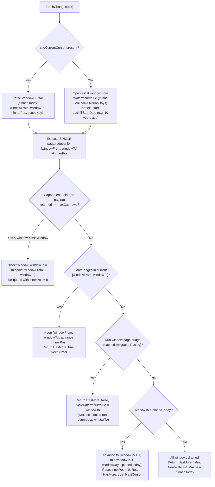

# Higher Logic Connectors — Full-History Migration,Metered Pacing & Legacy API Windowing Plan

> **Status:** Draft Design Proposal (Plan-Only PR)  
> **Scope:**  
> - `Platform/HigherLogicThriveCommunity` (`@memberjunction/connector-higher-logic-thrive-community`)  
> - `Platform/HigherLogicVanilla` (`@memberjunction/connector-higher-logic-vanilla`)  
> - `Marketing/Informz` (`@memberjunction/connector-informz` — Higher Logic Thrive Marketing Professional)  
> - `Marketing/MagnetMail` (`@memberjunction/connector-magnetmail` — Higher Logic Thrive Marketing Enterprise)

---

## 1. Executive Summary & Motivation

Associations using Higher Logic across **Community** (Thrive Community, Vanilla) and **Marketing** (Thrive Marketing Professional / Informz, Thrive Marketing Enterprise / MagnetMail) need MemberJunction to support two high-value scenarios:

1. **Deep Multi-Year Historical Sync for MJ Analytics:** Ingesting years of community engagement (discussions, threads, posts, reactions, events, library contributions) alongside granular, **recipient-level marketing behaviors** (individual sends, deliveries, opens, link clicks, bounces, unsubscribes, and web page tracking) tied back to member records.
2. **Full Community Platform Migration / Archival:** Extracting the complete historical record of a community — including optional member-to-member **private messages (`Messaging`)** and **social connection graphs (`Friends`)** — to archive in MJ or port to a new community platform.

Executing multi-year historical syncs against Higher Logic's APIs exposes three structural challenges that this design solves:

| Challenge | Root Cause in Higher Logic APIs | Proposed Solution |
|---|---|---|
| **1. Missing Private / Social Objects for Full Migrations** | `Messaging` (inbox/sent messages) and `Friends` (friend connections/requests) exist in the Thrive Community API v2.0 HelpPage catalog (`236` ops) but were excluded from the initial connector catalog (`Configuration.OutOfScopeObjectFamilies`) as non-AMS data. | Add `InboxMessages`, `SentMessages`, `Friends`, and `FriendRequests` to the Thrive Community catalog as **opt-in objects** (`Status = 'Disabled'` or gated by connection config `includePrivateSocialObjects`), plus wire GET `firstRecord`/`maxRecords` offset paging. |
| **2. Punitive Vendor Rate Limits & IP Blocks During Long Migrations** | Thrive Community documents ~180–240 req/min acceptable-use guidance where spikes risk **IP blocking** (no `Retry-After` header). Vanilla enforces a hard **250 req / 10s manual-intervention IP ban**. Informz & MagnetMail legacy SOAP endpoints time out under concurrent or deep-offset load, and MJ's engine enforces a 30s `FetchChanges` call timeout (`FetchChangesMs`). | Add **connection-configurable migration pacing & run budgets** (`tokensPerSec`, `burst`, `maxConcurrency`, `maxWindowsPerRun`, `maxPagesPerRun`) so multi-day historical migrations can run as tightly metered, resumable scheduled tasks without risking IP bans or 30s timeouts. |
| **3. Legacy API Lookback Caps, Missing Cursors & Deep-Offset Timeouts** | Thrive Community caps several endpoints (`ResourceLibraryDocuments` defaults to `DaysBack=30, MaxRecords=10`; `Events` uses `GetUpcoming`; `DiscussionThreads` caps at `maxToRetrieve`). MagnetMail has 5 different WSDL date-range parameter conventions (`SearchStartDate`/`SearchEndDate`, `fromDate`/`toDate`, etc.) that aren't wired to a sliding window. Informz uses open-ended `GT` date conditions that force deep `StartRow` offset scans across millions of activity rows. | Implement a **stateful sliding date-window & adaptive bisection engine** (`<pinnedToday>|<windowFrom>|<windowTo>|<innerOffsetOrPage>|<scopeKey>`) that slices multi-year history into bounded windows, pages or bisects within each window, and persists progress in MJ watermarks. |

---

## 2. Workstream 1: Opt-In `Messaging` & `Friends` in Thrive Community

### 2.1 Vendor API Surface (Thrive Community API v2.0)

In `Platform/HigherLogicThriveCommunity/metadata/integration/.higher-logic-thrive-community.integration.json`, both controllers are confirmed present in the HelpPage catalog:

* **`Messaging` Controller:**
  * `GET /v2.0/Messaging/GetInboxMessages?firstRecord={firstRecord}&maxRecords={maxRecords}`
  * `GET /v2.0/Messaging/GetSentMessages?firstRecord={firstRecord}&maxRecords={maxRecords}`
  * *Pagination:* Uses query-parameter offset (`firstRecord` + `maxRecords`), explicitly noted in `Configuration.PaginationConventions.offset.correctionNote`.
  * *Write path (for bidirectional/migration target):* `POST /v2.0/Messaging/SendMessage`
* **`Friends` Controller:**
  * `GET /v2.0/Friends/GetMyFriends` (returns the authenticated/scoped member's friend list)
  * `GET /v2.0/Friends/GetFriendRequestsSent` / `GET /v2.0/Friends/GetFriendRequestsReceived`
  * *Write path:* `POST /v2.0/Friends/SendFriendRequest`

### 2.2 Catalog & Opt-In Modeling

Standard AMS analytics deployments typically do not want private 1:1 messages synced into the warehouse by default, whereas full community migrations require them.

1. **Metadata Additions (`.higher-logic-thrive-community.integration.json` + SQL/PG Migrations):**
   * Add `InboxMessages`, `SentMessages`, `Friends`, and `FriendRequests` as declared `MJ: Integration Objects` with their HelpPage-derived `MJ: Integration Object Fields`.
   * Stamp `"optInCategory": "private-social"` and `"defaultEnabled": false` inside each object's `Configuration` JSON.
   * Remove `Messaging` and `Friends` from `Integration.Configuration.OutOfScopeObjectFamilies`.
2. **Opt-In Activation Behavior:**
   * By default, these objects remain available in the catalog for explicit EntityMap selection when an operator configures a migration project, or can be toggled via `CompanyIntegration.Configuration.includePrivateSocialObjects = true`.
3. **Pagination & Member-Scope Iteration in `HigherLogicThriveCommunityConnector.ts`:**
   * Extend `PageScheme` in [`HigherLogicThriveCommunityConnector.ts`](../Platform/HigherLogicThriveCommunity/src/HigherLogicThriveCommunityConnector.ts) from `'none' | 'seek-key' | 'continuation-token' | 'marker-direction' | 'offset'` to include `'query-offset'`:
     ```ts
     type PageScheme =
         | 'none'
         | 'seek-key'
         | 'continuation-token'
         | 'marker-direction'
         | 'offset'        // POST body: { StartRecord, EndRecord } (CommunityMembers)
         | 'query-offset'; // GET query: ?firstRecord=<0-or-1-based>&maxRecords=<limit> (Messaging)
     ```
   * In `describePagination()`, classify objects whose `paginationDetail.params` contain `firstRecord` and `maxRecords` as `Scheme: 'query-offset'`, `ReadMethod: 'GET'`.
   * **Member-Scoped Fan-Out (`GetMyFriends` / `GetInboxMessages`):** Because `GetMyFriends` and `GetInboxMessages` are scoped to a user context (or accept an optional contact/user scope parameter when called with an admin IAM credential), support an optional parent-key walk over `Contacts` (`ContactKey` / `LegacyContactKey`) when configured via `Configuration.parentScopeObject = "Contacts"`, encoding the current parent `ContactKey` in the compound cursor so the fan-out is 100% resumable across batches.

---

## 3. Workstream 2: Stateful Sliding Date-Window Engine for Legacy APIs

### 3.1 Core Windowing State Machine (`WindowCursor`)

Following the proven pattern in [`GA4Window.ts`](../Marketing/GA4/src/GA4Window.ts) and [`HubSpotConnector.ts`](../CRM/HubSpot/src/HubSpotConnector.ts), we introduce a shared, pure windowing state machine (`Shared/window-cursor` or per-connector helper) that turns any legacy date-bounded or lookback-capped API into a deterministic, resumable stream.

#### Cursor Wire Format

```
v1|<pinnedToday>|<windowFrom>|<windowTo>|<innerPosition>|<scopeKey>
```

* **`pinnedToday`** (`YYYY-MM-DD` or ISO-8601 timestamp): Pinned when a sync run opens its first window so a run crossing midnight never shifts the window boundaries mid-page.
* **`windowFrom` / `windowTo`**: The inclusive `[from, to]` bounds of the current slice.
* **`innerPosition`**: The page number (`1, 2, ...`), row offset (`0, 1000, ...`), or continuation token *within* the current `[windowFrom, windowTo]` slice.
* **`scopeKey`**: Optional parent key (e.g., `libraryKey`, `communityKey`, `MessageId`) when an endpoint requires iterating parent containers within or across windows.

#### State Transitions



#### Why One Request Per `FetchChanges` Call Matters
MemberJunction's Integration Engine wraps each `FetchChanges` invocation in a 30-second timeout (`FetchChangesMs = 30_000`), and timeouts trigger retries via a non-cancelling `Promise.race`. By issuing **one page/window request per `FetchChanges` call** and returning `HasMore: true` with `NextCursor`, the engine's outer batch loop drives pagination safely, checkpoints progress to the database, and never trips the 30-second watchdog.

---

### 3.2 Applying Windowing to Higher Logic Thrive Community

Several Thrive Community objects currently use `PaginationType: 'None'` with a single-call cap or rolling lookback window. We upgrade them as follows:

| Object | Current Endpoint & Limitation | Upgraded Windowed / Parent-Walk Strategy |
|---|---|---|
| **`Events`** | `GET /v2.0/Events/GetUpcoming?maxRecords=100` — only fetches upcoming events, missing years of past events. | Switch historical/windowed reads to `POST /v2.0/Events/SearchEvents` (or `GetEvents` by date range) passing `StartDate: windowFrom, EndDate: windowTo, MaxRecords: 500`. If a window hits `MaxRecords`, bisect the window down to 1-day granularity. |
| **`ResourceLibraryDocuments`** | `POST /v2.0/ResourceLibrary/GetLibraryDocuments` (`DaysBack: 30, MaxRecords: 10`) or `GetMyLibraryDocuments` — caps at 10–100 rows with no continuation token. | **Two-axis walk:**<br/>1. Walk parent libraries (`GET /v2.0/ResourceLibrary/GetLibraryList` → `libraryKey`) or step `DaysBack` windows with raised `MaxRecords` (e.g., `1000`).<br/>2. When a `DaysBack` horizon is used on incremental runs, dynamically compute `DaysBack = ceil((now - WatermarkValue) / 1d) + 2` so no gap occurs between runs. |
| **`DocumentAttachments`** | `GET /v2.0/ResourceLibrary/GetDocumentAttachments?documentKey={key}` — requires `documentKey`. | Walk parent `DocumentKey` values from synced `ResourceLibraryDocuments` via the compound cursor's `scopeKey`. |
| **`CommunityMembers`** | `POST /v2.0/Communities/GetCommunityMembers` (`StartRecord`/`EndRecord` offset). | Full initial backfill uses `StartRecord`/`EndRecord` across each `CommunityKey` (from `Communities`). Subsequent incremental runs (`WatermarkValue` present) can optionally use `POST /v2.0/System/GetCommunityMemberUpdates` with `{ StartDate: windowFrom, EndDate: windowTo }`. |
| **`DiscussionThreads`** | `GET /v2.0/Discussions/GetRecentThreads?maxToRetrieve=100` — single global cap when `discussionKey` is omitted. | Iterate parent `DiscussionKey` values from `Discussions` (`scopeKey` in cursor) with raised `maxToRetrieve` so every forum's thread list is retrieved, while `DiscussionPosts` (`GetPagedDiscussionPosts`) continues to pull every individual post via continuation token. |

---

### 3.3 Applying Windowing to Higher Logic Thrive Marketing Enterprise (MagnetMail)

[`MagnetMailConnector`](../Marketing/MagnetMail/src/MagnetMailConnector.ts) talks to the legacy SOAP 1.1 service (`mmapi.asmx`). Its frozen metadata (`Configuration.IncrementalWatermark` and `Configuration.PaginationDefaults`) documents **5 distinct date-range parameter conventions** and **4 pagination parameter conventions**, but `MagnetMailConnector.buildFetchArgs()` currently only checks a single flat `pageNumber`/`pageCount` and `IncrementalWatermarkField`:

```ts
// Current MagnetMailConnector.ts lines 746-755:
const pageParam = this.readConfigString(cfg, 'PageNumberParam') ?? 'pageNumber';
const sizeParam = this.readConfigString(cfg, 'PageCountParam') ?? 'pageCount';
args[pageParam] = page;
args[sizeParam] = pageSize;
```

#### Upgraded MagnetMail Windowing & Paging Matrix

We update [`.magnetmail.integration.json`](../Marketing/MagnetMail/metadata/integration/.magnetmail.integration.json) per-object `Configuration` and `MagnetMailConnector.buildFetchArgs()` to drive a sliding `[windowFrom, windowTo]` cursor across all recipient-level behavioral and message objects:

| Object(s) | SOAP `ListOperation` | Wrapper Element | Date-Window Params (`from` / `to`) | Paging Params (`page` / `size`) | What It Captures |
|---|---|---|---|---|---|
| **`MessageSentTrackingData`** | `GetMessageSentTracking` | `<criteria>` | `SearchStartDate` / `SearchEndDate` | `PageNo` / `PageSize` | Every individual recipient email send & delivery status (`RecipientId`, `MessageId`, `Date`, `Type`, `Status`). |
| **`MessageTrackingData`** | `GetMessageOpenTracking` | `<criteria>` | `SearchStartDate` / `SearchEndDate` | `PageNo` / `PageSize` | Every individual recipient email open event (`RecipientId`, `MessageId`, `Date`, `Type`). |
| **`MessageLinkTrackingData`** | `GetMessageLinkTracking` | `<criteria>` | `SearchStartDate` / `SearchEndDate` | `PageNo` / `PageSize` | Every individual recipient link click (`RecipientId`, `MessageId`, `Date`, `Url`, `LinkLabel`, `LinkText`). |
| **`UnsubscribeTrackingData`** | `GetUnsubscribeTracking` | `<criteria>` | `SearchStartDate` / `SearchEndDate` | `PageNo` / `PageSize` | Every recipient unsubscribe event with group/category context (`RecipientId`, `MessageId`, `Date`, `GroupId`). |
| **`TrackingDetails`**, **`recp_track`** | `getDetailedTrackingUTC` (or `getDetailedTracking`) | *(flat)* | `fromDate` / `toDate` | `page` / `recordsPerPage` | Detailed recipient delivery/open/status tracking rows (`recipient`, `ResultDate`, `OpenDate`, `Status`, `MMId`). |
| **`recp_unsubscribe`** | `getUnsubscribes` | *(flat)* | `fromDate` / `toDate` | *(window-sliced)* | Unsubscribe records across date slices. |
| **`Message`**, **`MessageList`** | `getMessageListUtc` / `getMessagesUTC` | *(flat)* | `sentStartDate` / `sentEndDate` | *(window-sliced)* | Sent messages/mailings over time. |
| **`subscription`** | `getSubscribedRecipients` | *(flat)* | `startDate` / `endDate` | *(window-sliced)* | Subscribed recipients in date window. |
| **`RecipientExtended`**, **`RecipientSuppressionList`** | `getSuppressedRecipientList` | *(flat)* | `start_date` / `end_date` | *(window-sliced)* | Suppressed recipients added in date window. |
| **`Recipient`** | `searchForRecipients` | `<criteria>` | `DateAddedAfter` / `DateUpdatedAfter` (or full scan) | `pageNo` / `pageSize` | Core recipient directory (`mail_user_id`, email, custom `MM_1..MM_42` fields). |

> **Result for MagnetMail:** Enabling `PaginationType: 'Cursor'` (windowed) on `MessageSentTrackingData`, `MessageTrackingData`, `MessageLinkTrackingData`, `UnsubscribeTrackingData`, and `recp_track` lets MJ pull years of recipient-level sends, opens, clicks, and unsubscribes in safe 7-to-30-day SOAP windows with `PageNo`/`PageSize` pagination inside each `<criteria>` block.

---

### 3.4 Applying Windowing to Higher Logic Thrive Marketing Professional (Informz)

[`InformzConnector`](../Marketing/Informz/src/InformzConnector.ts) queries 67 active AAPI grids via `PostInformzMessage` (`<GridRequest>`). Currently:
* 6 high-volume objects declare incremental sync (`Subscriber` on `modified_date`, `MailingActivityOpens` on `open_date`, `MailingActivityClicks` on `link_date`, `MailingActivityOptout` on `optout_date`, `SubscriberFormUsage` on `activity_date`, and `SubscriberInterestsDeleted` on `deleted_from_interest_date`).
* `watermarkConditions()` in [`InformzConnector.ts`](../Marketing/Informz/src/InformzConnector.ts#L728-L735) emits a **single open-ended condition**:
  ```xml
  <Conditions>
    <Condition>
      <Single>
        <DataElement>open_date</DataElement>
        <DataValue>2020-01-01 00:00:00</DataValue>
        <Comparator>GT</Comparator>
      </Single>
    </Condition>
  </Conditions>
  ```
* **Problem on multi-year backfills:** When backfilling 5+ years of `MailingActivityOpens` or `MailingActivityClicks` (often tens of millions of rows), a single `GT` condition forces `StartRow` offset pagination (`StartRow=1`, `1001`, ..., `5000001`) over the entire multi-year result set. Deep offset queries on legacy SQL-backed SOAP services degrade quadratically ($O(N^2)$) and eventually time out against the 30s request limit, and if interrupted before the final page, the watermark never advances.

#### Upgraded Informz Bounded-Window `<Conditions>`

1. **Two-Sided Window Conditions (`GTE` + `LT` or `BETWEEN`):**
   * When `windowDays` is configured (default `30` days for activity grids, configurable via `CompanyIntegration.Configuration.windowDays`), `InformzConnector` opens a `[windowFrom, windowTo]` slice starting at `WatermarkValue` (or `backfillStartDate` on cold start).
   * `watermarkConditions()` emits **both** lower and upper bound `<Condition><Single>` elements inside `<Conditions>`:
     ```xml
     <Conditions>
       <Condition>
         <Single>
           <DataElement>open_date</DataElement>
           <DataValue>2023-01-01 00:00:00</DataValue>
           <Comparator>GTE</Comparator>
         </Single>
       </Condition>
       <Condition>
         <Single>
           <DataElement>open_date</DataElement>
           <DataValue>2023-01-31 23:59:59</DataValue>
           <Comparator>LTE</Comparator>
         </Single>
       </Condition>
     </Conditions>
     ```
   * `StartRow` pages from `0`/`1` only within that 30-day slice. Once the slice drains, the cursor advances to the next 30-day slice and resets `StartRow`.
2. **Additional Date-Filterable Grids:**
   * Audit the remaining `SubscriberMailingHistory`, `SubscriberWebTracking`, `SubscriberWebTrackingPages`, `SubscriberWebTrackingInteractions`, and `Mailing` grids in `.informz.integration.json`: for grids where the date element (`Mailing_date`, `create_date`, `activity_date`) is documented as `Conditional=True` in the Higher Logic Help Center snapshot, enable date-windowed backfills so web tracking and mailing history also slice cleanly by date range.

---

## 4. Workstream 3: Metered Migration Pacing & Run-Budget Controls

A full historical migration of a 10-year Higher Logic community or marketing account may involve hundreds of thousands of API calls. Running flat-out risks triggering vendor IP blocks (which require filing a support ticket with Higher Logic / Vanilla Support to lift) or starving the live community site.

### 4.1 Connection-Level Pacing Configuration Schema

We standardize a `migrationPacing` (and top-level shorthand) configuration block in `CompanyIntegration.Configuration` across all four Higher Logic connectors:

```json
{
  "migrationPacing": {
    "enabled": true,
    "tokensPerSec": 1.5,
    "burst": 3,
    "maxConcurrency": 1,
    "minDelayBetweenRequestsMs": 500,
    "maxRequestsPerRun": 250,
    "maxWindowsPerRun": 10,
    "windowDays": 14,
    "backfillStartDate": "2016-01-01",
    "lookbackOverlapDays": 2,
    "checkpointPerWindow": true
  }
}
```

### 4.2 How the Pacing & Budget Controls Work Together

1. **Dynamic `RateLimitPolicy` & `MaxConcurrencyHint` + Inter-Request Pacing:**
   * In `@memberjunction/integration-engine`, `RateLimitPolicy` and `MaxConcurrencyHint` are getters on `BaseIntegrationConnector` (no `companyIntegration` parameter).
   * Each Higher Logic connector caches the active connection's `migrationPacing` settings during `Authenticate(companyIntegration, contextUser)` / `FetchChanges(ctx)` and:
     * Exposes the active `tokensPerSec` / `burst` / `maxConcurrency` via `RateLimitPolicy` and `MaxConcurrencyHint` for the engine's [`RateLimiter`](https://github.com/MemberJunction/MJ/blob/next/packages/Integration/engine/src/RateLimiter.ts) and concurrency governor.
     * Enforces an explicit per-connection `minDelayBetweenRequestsMs` floor inside the connector's `MakeHTTPRequest` / `SendHTTP` transport seam as a defense-in-depth guard (guaranteeing Vanilla never approaches the 250 req / 10s manual IP-ban cliff and Thrive Community stays well below 180 req/min even across retries).
2. **Bounded Task Runs (`maxRequestsPerRun` / `maxWindowsPerRun`) with Durable State Checkpoints:**
   * During a multi-day migration, an operator schedules the MJ sync job to run every $N$ minutes (e.g., every 15 or 30 minutes).
   * Inside `FetchChanges`, the connector tracks the number of requests and completed date windows in the current run.
   * When a window completes and `windowsCompleted >= maxWindowsPerRun` (or `requestsIssued >= maxRequestsPerRun` at a window/page boundary):
     * **For date-windowed objects:** The connector returns `HasMore: false` and sets `NewWatermarkValue = currentWindow.To`. The engine persists `WatermarkValue = currentWindow.To` in `__mj.CompanyIntegrationSyncWatermark` and finishes the object cleanly. The next scheduled task run automatically starts at `currentWindow.To`!
     * **For cursor/seek-paginated objects without a date watermark (e.g., `Contacts`, `DiscussionPosts`, `InboxMessages`):** The engine's existing keyset resume checkpointing (`WatermarkService.SaveKeysetPosition`, `WatermarkType = 'Cursor'`) or a persisted cursor checkpoint in `NewWatermarkValue` records the exact key/offset reached so the next run resumes from `after<X>Key` / `continuationToken` / `firstRecord` rather than restarting at record 1.

---

## 5. Concrete Task Breakdown & Implementation Phases

### Phase 1: Shared Windowing & Pacing Primitives (`Shared/`)
- [ ] **Task 1.1:** Create a pure, zero-dependency window-cursor & pacing utility (or shared package under `Shared/`) supporting:
  - `WindowCursor` parse/format (`v1|<pinnedToday>|<windowFrom>|<windowTo>|<innerPos>|<scopeKey>`).
  - `initialWindow()`, `nextWindow()`, and `bisectWindow()` (for capped legacy endpoints that hit `MaxRecords`).
  - `MigrationPacingConfig` parser (`tokensPerSec`, `burst`, `maxConcurrency`, `minDelayBetweenRequestsMs`, `maxRequestsPerRun`, `maxWindowsPerRun`, `windowDays`, `backfillStartDate`, `checkpointPerWindow`).
- [ ] **Task 1.2:** Unit tests covering cold-start windowing, midnight rollover pinning, window bisection on cap hits, and run-budget early-exit checkpointing.

### Phase 2: Higher Logic Thrive Community (`Platform/HigherLogicThriveCommunity`)
- [ ] **Task 2.1 (Opt-in `Messaging` & `Friends`):**
  - Extract field schemas for `InboxMessages`, `SentMessages`, `Friends`, and `FriendRequests` from the HelpPage v2.0 catalog and add them to `.higher-logic-thrive-community.integration.json`.
  - Add SQL Server and PostgreSQL migrations (`migrations/` and `migrations-pg/`) seeding the new `IntegrationObject` and `IntegrationObjectField` rows.
  - Add `'query-offset'` (`firstRecord` + `maxRecords` over GET) pagination support to `HigherLogicThriveCommunityConnector.ts`.
  - Add connection config flag `includePrivateSocialObjects` (default `false`) and optional parent `Contacts` scope iteration.
- [ ] **Task 2.2 (Capped Endpoint Windowing & Parent Iteration):**
  - `Events`: Support windowed `POST /v2.0/Events/SearchEvents` (`StartDate` / `EndDate`) with automatic window bisection when `MaxRecords` is hit.
  - `ResourceLibraryDocuments` & `DocumentAttachments`: Raise `MaxRecords` ceiling, support dynamic `DaysBack` calculation from `WatermarkValue`, and support parent `libraryKey` / `documentKey` iteration via cursor `scopeKey`.
  - `CommunityMembers`: Support `POST /v2.0/System/GetCommunityMemberUpdates` (`StartDate` / `EndDate`) for windowed incremental syncs alongside `StartRecord`/`EndRecord` full backfills.
  - `DiscussionThreads`: Support parent `discussionKey` iteration across `Discussions`.
- [ ] **Task 2.3 (Metered Pacing):** Wire `migrationPacing` config overrides into `HigherLogicThriveCommunityConnector`.

### Phase 3: Higher Logic Vanilla (`Platform/HigherLogicVanilla`)
- [ ] **Task 3.1 (Metered Pacing & Hard-Block Guard):**
  - Wire `migrationPacing` config overrides (`tokensPerSec`, `minDelayBetweenRequestsMs`, `maxPagesPerRun`) into [`HigherLogicVanillaConnector`](../Platform/HigherLogicVanilla/src/HigherLogicVanillaConnector.ts) to guarantee bulk migrations stay safely below Vanilla's 250 req / 10s manual-intervention IP ban.
  - Add optional date-windowed slicing (`dateUpdated=>=<from>&dateUpdated=<`<to>`) for `Discussion`, `Comment`, and `User` when `windowDays` is configured on multi-year backfills.

### Phase 4: Higher Logic Thrive Marketing Enterprise / MagnetMail (`Marketing/MagnetMail`)
- [ ] **Task 4.1 (5-Convention Date Windowing & Criteria Paging):**
  - Update `.magnetmail.integration.json` per-object `Configuration` on `MessageSentTrackingData`, `MessageTrackingData`, `MessageLinkTrackingData`, `UnsubscribeTrackingData`, `TrackingDetails`, `recp_track`, `recp_unsubscribe`, `Message`, `MessageList`, `subscription`, and `RecipientExtended` with their exact `WatermarkFromParam`, `WatermarkToParam`, `PageNumberParam` (`PageNo` / `page` / `pageNo`), and `PageCountParam` (`PageSize` / `recordsPerPage` / `pageSize`).
  - Update `MagnetMailConnector.FetchChanges()` and `buildFetchArgs()` to run the sliding `[windowFrom, windowTo]` cursor, paginating within each window and advancing `NewWatermarkValue` per completed window.
  - Add SQL Server and PostgreSQL metadata migrations for the updated `IntegrationObject` configurations.
- [ ] **Task 4.2 (Metered Pacing):** Wire `migrationPacing` config overrides into `MagnetMailConnector`.

### Phase 5: Higher Logic Thrive Marketing Professional / Informz (`Marketing/Informz`)
- [ ] **Task 5.1 (Bounded Date-Window `<Conditions>`):**
  - Upgrade `InformzConnector.FetchChanges()` and `watermarkConditions()` to emit two-sided `[windowFrom, windowTo]` `<Condition><Single>` blocks (`GTE` + `LTE`) when windowing is active, paging `StartRow` only within each window and advancing the watermark window-by-window.
  - Enable windowed backfills on additional date-conditional behavioral/history grids (`SubscriberMailingHistory`, `SubscriberWebTracking`, `SubscriberWebTrackingPages`, `SubscriberWebTrackingInteractions`, `Mailing`) where supported by the AAPI schema.
- [ ] **Task 5.2 (Metered Pacing):** Wire `migrationPacing` config overrides into `InformzConnector`.

### Phase 6: Catalog Regeneration, Linting & Verification
- [ ] **Task 6.1:** Run `npm run build:catalog` and all repo lint gates (`lint-catalog-freshness-pin.mjs`, `lint-writable-pk.mjs`, migration parity checks).
- [ ] **Task 6.2:** Add unit and mock-transport E2E tests across all 4 packages proving:
  - Multi-window historical backfills advance `NextCursor` across windows and persist `NewWatermarkValue` on window completion / run-budget exit.
  - Window bisection splits capped responses without dropping records.
  - `Messaging` and `Friends` paginate via `firstRecord`/`maxRecords` and respect opt-in gating.
  - `MagnetMail` and `Informz` recipient behavioral objects (`MessageSentTrackingData`, `MessageTrackingData`, `MessageLinkTrackingData`, `MailingActivityOpens`, `MailingActivityClicks`, etc.) emit the exact expected XML/SOAP date-window envelopes.
- [ ] **Task 6.3:** Update `docs/SUPPORT.md` on all four connectors to reflect the new objects, windowing capabilities, and pacing configuration.

---

## 6. Open Questions for Review (@MS-BC)

1. **Opt-in mechanism for `Messaging` and `Friends` in Thrive Community:** Should `InboxMessages`, `SentMessages`, `Friends`, and `FriendRequests` be seeded with `Status = 'Active'` (and skipped unless mapped or `includePrivateSocialObjects: true` is set in `CompanyIntegration.Configuration`), or seeded with `Status = 'Disabled'` so an operator flips them to `Active` when setting up a community migration?
2. **Default `windowDays` for Marketing Activity Backfills:** For `Informz` (`MailingActivityOpens`, `MailingActivityClicks`) and `MagnetMail` (`GetMessageSentTracking`, `GetMessageOpenTracking`, `GetMessageLinkTracking`), is **14 days** or **30 days** the preferred default window width when `backfillStartDate` is configured?
3. **Run-Budget Checkpoint Default (`maxWindowsPerRun` / `maxRequestsPerRun`):** When `migrationPacing.enabled = true`, should `checkpointPerWindow` default to `true` (persisting `NewWatermarkValue = windowTo` whenever a run hits its request/window budget so each scheduled run commits a durable slice)?
